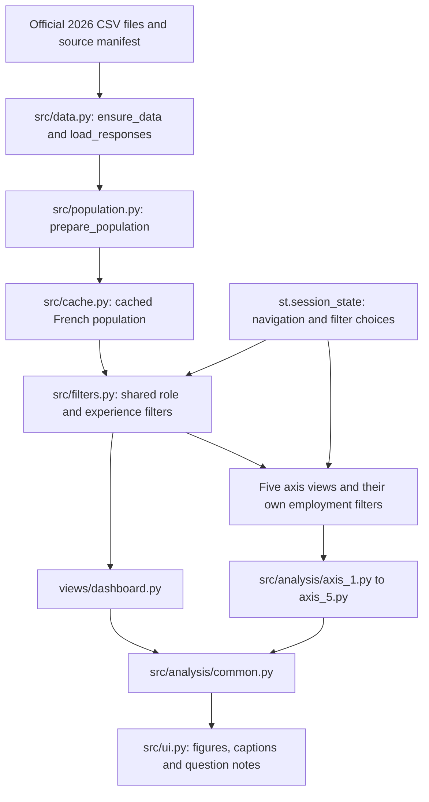

# Technical architecture

## One app, shared calculations, five owners

`app.py` is the only entry point. Its sidebar chooses one of six view modules; these are not six separate apps. Navigation uses a simple radio control. `views/` contains Streamlit presentation only; calculations in `src/analysis/` have no Streamlit dependency.

## Features, files and functions

| Feature | Main files and functions |
|---|---|
| Verified download | `config/sources.json`; `src/data.py: ensure_data`, `file_hash`; CLI `scripts/download_data.py` |
| One row per response | `src/data.py: load_responses`, checking unique `ResponseId` |
| Scope and derived fields | `src/population.py: prepare_population`, `ai_status` |
| Shared loading cache | `src/cache.py: get_population`, `get_schema` |
| Filtering | `src/filters.py: filter_population`; common widgets in `app.py`; `src/ui.py: local_population` |
| Navigation | `app.py: pages` registry and sidebar radio |
| Main message and indicators | `views/dashboard.py: render`; `known_rate`, `frequency_table` |
| Per-axis calculations | `src/analysis/axis_N.py: summarise` |
| Per-axis views | `views/axis_N.py: render` |
| Consistent figures | `src/ui.py: draw_frequency`, `draw_adoption`, `population_caption`, `question_note` |
| Reproducible explorations | `notebooks/00_shared_audit.ipynb`, `01` to `05` owner notebooks |

## Data flow and calculation rules

1. The downloader checks existing files or downloads `.part` files, verifies size and SHA-256, then renames successful downloads. Failures are explicit; a Git LFS pointer is not accepted as CSV data.
2. The CSV reader validates unique 2026 response IDs. Raw files remain in ignored `data/raw/2026/`.
3. Preparation keeps France and coding as the primary part of the job, without excluding missing AI answers. It derives a nullable AI-use indicator and experience groups.
4. Shared filters reduce the 628 eligible records. Empty selections mean no restriction. Selected experience groups exclude unknown experience; the resulting count is visible.
5. Each axis can further restrict employment status. Its view selector chooses a verified source field.
6. Analysis functions compute answer-level denominators and frequencies. UI helpers render figures and attach population captions both below and inside images.

## Cache versus session state

`@st.cache_data` stores the prepared public-data population and the schema at server scope. Each caller receives a copy. Reading and preparing 123 MB is the expensive step; role filtering and small summaries are recomputed rather than creating one cache entry for every combination. No database connection, model or private user object is cached.

After changing the source manifest, data files or indirectly called preparation functions, use **Clear cache** in Streamlit or restart the server. Changing an imported helper alone need not invalidate the wrapper's cache.

Session state contains `navigation`, `global_roles`, `global_experience`, `axis_N_employment` and `axis_N_view`. Widgets have unique keys and `persist_state="session"`, supported by the pinned Streamlit 1.67.0. Local choices survive switching views and never overwrite another axis's choices. A fresh browser session has its own filters; public cached data is shared. A page reload can reset session state. Raw responses and calculated results are not manually stored in session state.

## Small samples and missing values

No chart is shown with fewer than 20 answered responses. Profile rates are suppressed for groups below 20, while their counts remain in the table. This is a practical initial rule, not a statistical guarantee. Missing values never become non-use; conditional question skips are not interpreted as negative answers. Used, desired and workflow-status columns keep separate denominators.

## Boundaries

2025 is not loaded. No authentication or private staff data is handled. No inference of causal impact or representative market share is implemented. A deployment URL is a possible later bonus, not an existing deliverable.
